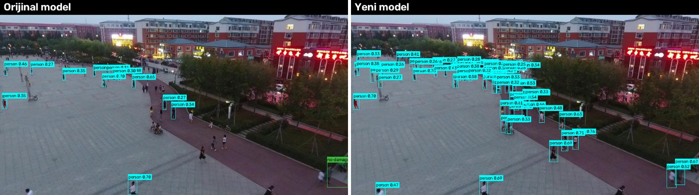
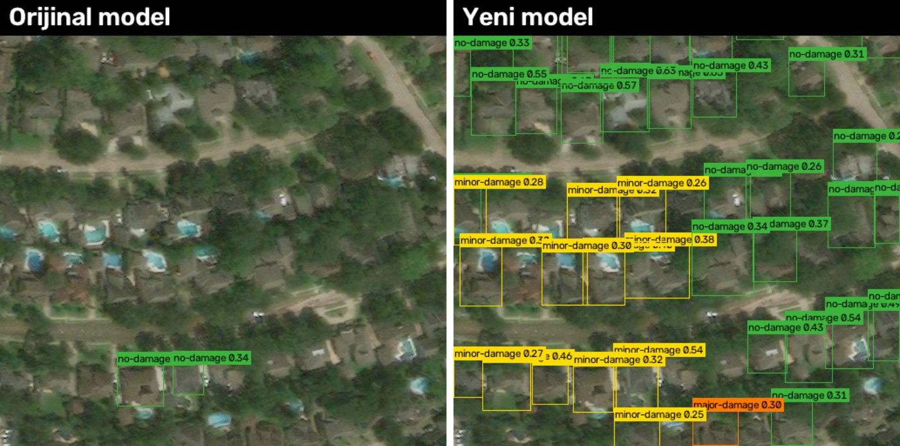

<div align="center">

# 🌍 DisasterVision AI: Yapay Zeka Destekli Otonom Hasar ve İnsan Tespit Sistemi

<p align="center">
  
  
  
  
</p>

Afet bölgelerinde havadan (İHA/drone ve uydu) çekilen görüntüler üzerinden bina hasar durumunu tespit eden ve insan varlığını algılayan bilgisayarla görü projesi.

</div>

---

## 📌 Proje Durumu

✅ **Tamamlandı.** Proje daha önce *"mevcut veri setlerinin çeşitlilik ve miktar olarak yetersiz kalması"* nedeniyle durdurulmuştu. Bu sürümde veri sorunu çözüldü:

* **İnsan sınıfı** için 8.600+ drone görüntüsü içeren **VisDrone2019-DET** eklendi.
* **Hasar sınıfları** için 850.000+ bina etiketli **xBD (xView2)** veri setinden ~5.400 döşeme eklendi.
* Orijinal veri hattındaki iki hata düzeltildi (aşağıda).
* Model yeniden eğitildi; eğitimde **hiç görülmemiş** iki bağımsız test setinde ölçüldü.
* Döşemeli çıkarım (SAHI) ve Gradio arayüzü eklendi.

<p align="center"><br/><em>VisDrone test-dev (eğitimde kullanılmadı): orijinal model 15, yeni model 79 kişi buluyor (gerçekte 91).</em></p>

<p align="center"><br/><em>xBD test, Hurricane Harvey (eğitimde kullanılmadı): orijinal model 2 bina görüyor; yeni model binaları buluyor ve çoğunu doğru sınıflıyor.</em></p>

---

## 📊 Sonuçlar

Üç model aynı test setlerinde karşılaştırıldı (AP50, `conf=0.001`, `imgsz=640`):

| Test seti | Orijinal yöntem¹ | + VisDrone + xBD tier3 | **Son model** |
| :--- | :---: | :---: | :---: |
| **Gerçek drone görüntüsünde insan** (VisDrone test-dev, 3.057 döşeme) | 0.022 | 0.345 | **0.343** |
| **Farklı afetlerde bina hasarı** (xBD test, 337 döşeme), mAP50 | 0.054 | 0.130 | **0.294** |
| &nbsp;&nbsp;↳ yıkık / ağır / hafif / hasarsız | .014 / .004 / .005 / .192 | .048 / .050 / .057 / .363 | **.122 / .312 / .244 / .497** |
| Orijinal Roboflow test seti, mAP50 | 0.497 | 0.516 | **0.520** |

¹ Orijinal defterdeki düzen (YOLOv8s, yalnız Roboflow verisi) aynı donanımda yeniden eğitildi.

**Yorum:** Orijinal model yalnızca eğitildiği veriye benzeyen görüntülerde çalışıyordu (Roboflow testi 0.50). Gerçek drone görüntüsünde insanları neredeyse hiç bulamıyor (0.02), başka afetlerde de hasarı göremiyordu (0.05). Yeni model orijinal testte aynı seviyede kalırken bağımsız testlerde **5–15 kat** daha iyi.

### Orijinal veri hattında bulunan hatalar
1. **Kopya veri seti:** `damaged-buildings-vrcqx` (v8), `damaged-building-detection-zenbx` (v2) setinin birebir alt kümesi (aynı döşemeler, aynı bölümler). Defter ikisini birden ekliyor, aynı görüntüleri iki kez eğitiyordu. Benzersiz hasar verisi aslında yalnızca 531 döşemeydi.
2. **Açıkta API anahtarı:** Roboflow anahtarı herkese açık defterde düz metin olarak duruyordu. Artık `ROBOFLOW_API_KEY` ortam değişkeninden okunuyor.

### Sınırlamalar
* Hasar tespiti yalnızca **afet sonrası** tek görüntüyle yapılıyor. Sel ve hafif hasar çatıdan çoğu zaman görünmüyor; yıkık sınıfı (binanın tamamen yok olduğu durumlar) hâlâ en zor sınıf. xView2 yarışmasında en iyi sonuçlar afet öncesi/sonrası görüntü çiftiyle alınıyor; bu bir sonraki adım olabilir.
* Roboflow insan test seti, eğitimle aynı videonun karelerinden oluştuğu için iyimser sonuç veriyor (0.92). Gerçekçi ölçüt VisDrone testi.
* Sonuçlar karar desteği içindir; saha ekiplerince doğrulanmalıdır.

---

## 🎯 Projenin Amacı ve Kapsamı

| Özellik | Açıklama |
| :--- | :--- |
| 🏢 **Çok Sınıflı Hasar** | Binaların durumunu 4 kategoride sınıflandırma (`destroyed`, `major-damage`, `minor-damage`, `no-damage`). |
| 👤 **İnsan Tespiti** | Afet sahasındaki arama-kurtarma faaliyetlerine destek olmak amacıyla insan siluetlerinin tespiti (`person`). |
| 🔄 **Veri Mühendisliği** | Dört kaynağın ortak şemada birleştirilmesi; sınıf kimliklerinin **ada göre** eşlenmesi. |
| 🔍 **Döşemeli Çıkarım** | Büyük görüntülerde küçük insanları kaçırmamak için SAHI ile parçalı tahmin. |

---

## 🗂️ Veri Kaynakları

| Kaynak | Kullanım | Eğitimdeki pay | Lisans |
| :--- | :--- | :--- | :--- |
| [Roboflow: disaster](https://universe.roboflow.com/akash-gnbdg/disaster-dnaqz) | insan (eğik açılı drone) | 911 görüntü | Roboflow Universe |
| [Roboflow: damaged-building-detection](https://universe.roboflow.com/damaged-building-detection/damaged-building-detection-zenbx) | hasar (Hurricane Maria) | 1.119 görüntü | Roboflow Universe |
| [VisDrone2019-DET](https://github.com/VisDrone/VisDrone-Dataset) | insan (`pedestrian` + `people`) | 4.000 döşeme (960 px) | yalnızca akademik |
| [xBD / xView2](https://xview2.org) ([HF aynası](https://huggingface.co/datasets/EVER-Z/torchange_xView2)) | hasar (19 afet) | 5.387 döşeme (512 px) | CC BY-NC-SA 4.0 |

* xBD maskelerinden her hasar seviyesinin bağlı bileşenleri bina kutusuna çevrilir. Yalnız hasarsız bina içeren döşemelerin %85'i atılarak sınıf dengesi iyileştirilir.
* **Sızıntı önlemi:** Roboflow hasar seti xBD'nin Hurricane Maria görüntülerinden türetildiği için Maria görüntüleri eğitime alınmaz. xBD testi, resmî `test` bölümünden gelir.
* Eğitim seti: 11.417 görüntü; 56.791 insan, 12.476 yıkık, 14.503 ağır, 16.401 hafif, 68.479 hasarsız bina.

> ⚠️ xBD ve VisDrone ticari olmayan kullanım içindir; bu verilerle eğitilen model de aynı kısıtı taşır.

---

## 📊 Sınıf Hiyerarşisi

| ID | Sınıf | Açıklama |
|:-:|---|---|
| 0 | `person` | İnsan |
| 1 | `destroyed` | Yıkık bina |
| 2 | `major-damage` | Ağır hasarlı |
| 3 | `minor-damage` | Hafif hasarlı |
| 4 | `no-damage` | Hasarsız |

---

## 🚀 Kurulum ve Kullanım

```bash
python -m venv .venv && .venv\Scripts\activate          # Linux/Mac: source .venv/bin/activate
pip install torch==2.5.1 torchvision==0.20.1 --index-url https://download.pytorch.org/whl/cu124
pip install -r requirements.txt
```

### Hazır modelle tahmin
Eğitilmiş ağırlıklar `modeller/disastervision.pt` dosyasında (YOLOv8s, 22 MB).

```bash
python app.py                                      # Gradio arayüzü → http://127.0.0.1:7860
python src/tahmin.py ornekler/drone_kalabalik.jpg  # komut satırı
python src/tahmin.py buyuk_goruntu.jpg --dilimle   # büyük görüntü: SAHI döşemeli çıkarım
```

```python
from ultralytics import YOLO
model = YOLO("modeller/disastervision.pt")
model.predict(source="fotograf.jpg", save=True, imgsz=640, conf=0.25)
```

### Modeli baştan üretmek
```bash
set ROBOFLOW_API_KEY=...                       # Linux/Mac: export ROBOFLOW_API_KEY=...
python src/veri_indir.py                       # Roboflow + VisDrone
# xBD: EVER-Z/torchange_xView2 deposundaki train-* ve tier3-* parquet dosyalarını veri/ham/xbd/ altına,
#      test-00000 dosyasını veri/ham/xbd_test/ altına indirin
python src/xbd_cevir.py --hasarsiz-oran 0.15   # xBD → YOLO döşemeleri
python src/xbd_cevir.py --test                 # bağımsız xBD test seti
python src/visdrone_dosele.py                  # VisDrone → 960 px döşemeler (+ test-dev)
python src/birlestir.py --visdrone-train 4000  # birleşik 5 sınıflı veri seti → veri/birlesik/

python src/egit.py --ad genis --veri veri/birlesik/data.yaml --epoch 60
python src/egit.py --ad genis2 --veri veri/birlesik/data.yaml --model runs/genis/weights/best.pt --epoch 40

python src/degerlendir.py runs/genis2/weights/best.pt --veri veri/xbd_test.yaml
python src/degerlendir.py runs/genis2/weights/best.pt --veri veri/visdrone_test.yaml
```
Eğitim RTX 3050 6 GB'ta yapıldı (batch 12, ~3 GB VRAM; toplam ~7 saat).

---

## 📁 Proje Yapısı

```text
├── app.py                  # Gradio arayüzü
├── modeller/disastervision.pt
├── src/
│   ├── veri_indir.py       # Roboflow + VisDrone indirme
│   ├── xbd_cevir.py        # xBD parquet → YOLO döşemeleri
│   ├── visdrone_dosele.py  # VisDrone → insan döşemeleri
│   ├── birlestir.py        # 5 sınıflı birleşik veri seti
│   ├── egit.py             # eğitim
│   ├── degerlendir.py      # karşılaştırmalı değerlendirme
│   └── tahmin.py           # tahmin + SAHI + çizim
├── ornekler/               # örnek görüntüler
├── docs/                   # karşılaştırma görselleri
└── Yapay-Zeka-...ipynb     # orijinal Colab defteri (tarihçe)
```

---

<div align="center">

**Geliştirici:** Barış Emre Rüzgar

</div>
