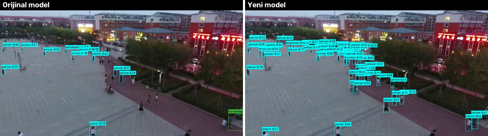
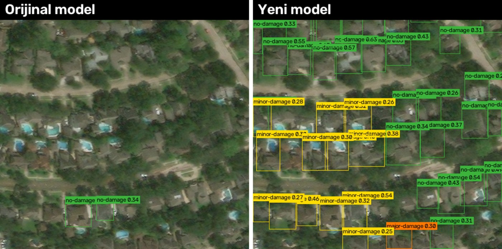
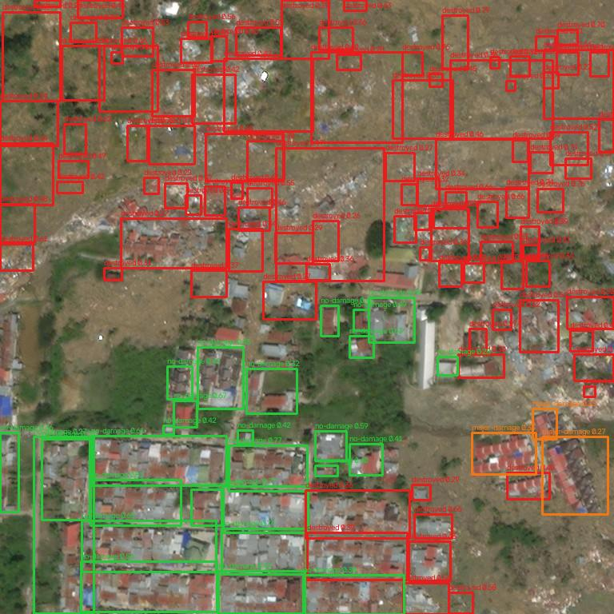

<div align="center">

# 🌍 DisasterVision AI: Yapay Zeka Destekli Otonom Hasar ve İnsan Tespit Sistemi

<p align="center">
  
  
  
  
</p>

Afet bölgelerinde havadan (İHA/drone ve uydu) çekilen görüntüler üzerinden bina hasar durumunu tespit eden ve insan varlığını algılayan bilgisayarla görü projesi.

</div>

---

## ⚡ Hızlı deneme (≈5 dakika, GPU gerekmez)

**🔗 Canlı demo — kurulum yok:** [huggingface.co/spaces/barisemreruzgar/disastervision](https://huggingface.co/spaces/barisemreruzgar/disastervision)  
Modeller tarayıcınızda çalışır (WebGPU varsa ekran kartı, yoksa işlemci); görüntü sunucuya gönderilmez. İlk açılışta ~90 MB model iner.

Yerelde çalıştırmak için (eğitilmiş modeller depoda, `modeller/`, her biri ~22 MB; ayrıca indirmeye gerek yok):

```bash
git clone https://github.com/BarisEmreRuzgar/Yapay-Zeka-Destekli-Otonom-Hasar-ve-Insan-Tespit-Sistemi-claude.git
cd Yapay-Zeka-Destekli-Otonom-Hasar-ve-Insan-Tespit-Sistemi-claude
pip install -r requirements.txt                       # CPU yeterli (GPU için: Kurulum bölümü)
python src/tahmin.py ornekler/drone_kalabalik.jpg     # → ornekler/drone_kalabalik_tespit.jpg + sınıf sayıları
python app.py                                         # tarayıcı arayüzü → http://127.0.0.1:7860
```

Kendi görüntünüz için: `python src/tahmin.py fotograf.jpg` (büyük drone karelerinde küçük insanlar için `--dilimle`,
su/sel sahnesinde `--su`). Sonuçlar karar desteği içindir; saha ekiplerince doğrulanmalıdır.

## 📌 Proje Durumu

🔄 **Çalışan bir sistem; geliştirme aktif olarak sürüyor.** Modeller kullanıma hazır ve aşağıdaki sonuçlarla ölçüldü;
yeni veri setleriyle iyileştirme çalışmaları devam ediyor (en son: gizlenmiş/kısmen görünen insanlar için NOMAD verisi),
her adım `docs/ilerleme.md` dosyasına kaydediliyor.

Proje daha önce *"mevcut veri setlerinin çeşitlilik ve miktar olarak yetersiz kalması"* nedeniyle durdurulmuştu. Bu sürümde veri sorunu çözüldü:

* **İnsan sınıfı** için 8.600+ drone görüntüsü içeren **VisDrone2019-DET** eklendi.
* **Hasar sınıfları** için 850.000+ bina etiketli **xBD (xView2)** veri setinden ~5.400 döşeme eklendi.
* Orijinal veri hattındaki iki hata düzeltildi (aşağıda).
* Model yeniden eğitildi; eğitimde **hiç görülmemiş** iki bağımsız test setinde ölçüldü.
* Döşemeli çıkarım (SAHI) ve Gradio arayüzü eklendi.

<p align="center"><br/><em>VisDrone test-dev (eğitimde kullanılmadı): orijinal model 15, yeni model 79 kişi buluyor (gerçekte 91).</em></p>

<p align="center"><br/><em>xBD test, Hurricane Harvey (eğitimde kullanılmadı): orijinal model 2 bina görüyor; yeni model binaları buluyor ve çoğunu doğru sınıflıyor.</em></p>

---

## 📊 Sonuçlar

Üç model aynı test setlerinde karşılaştırıldı (AP50, `conf=0.001`, `imgsz=640`):

| Test seti | Orijinal yöntem¹ | + VisDrone + xBD tier3 | **Son model** |
| :--- | :---: | :---: | :---: |
| **Gerçek drone görüntüsünde insan** (VisDrone test-dev, 3.057 döşeme) | 0.022 | 0.345 | **0.343** |
| **Farklı afetlerde bina hasarı** (xBD test, 337 döşeme), mAP50 | 0.054 | 0.130 | **0.294** |
| &nbsp;&nbsp;↳ yıkık / ağır / hafif / hasarsız | .014 / .004 / .005 / .192 | .048 / .050 / .057 / .363 | **.122 / .312 / .244 / .497** |
| Orijinal Roboflow test seti, mAP50 | 0.497 | 0.516 | **0.520** |

¹ Orijinal defterdeki düzen (YOLOv8s, yalnız Roboflow verisi) aynı donanımda yeniden eğitildi.

**Güncel sistem (`tahmin.py` / uygulama varsayılanı), tek seferlik testler:**

| Görev | Orijinal yöntem | Tek model (yukarıda) | **Güncel sistem** |
| :--- | :---: | :---: | :---: |
| İnsan, VisDrone test-dev | 0.022 | 0.343 | **0.463** (insan uzmanı v18, 1280 px; v16: 0.465) |
| İnsan, insan eylemleri drone videosu (Okutama-Action resmî test) | — | — | **0.844** (v11: 0.693; v16: 0.839) |
| İnsan, yaban arazisi arama-kurtarma (Lacmus test) | — | — | **0.903** (v16: 0.907) |
| İnsan, kayalık/orman arama-kurtarma (WiSARD val, görülmemiş 2 bölge, 960 döşeme) | — | — | **0.639** (v14: 0.420; v16: 0.599) |
| İnsan, ağaç/korkuluk arkasında yarı gizli (NOMAD val, görülmemiş 2 oyuncu, 960 döşeme) | — | — | **0.187** (v16: 0.163) |
| İnsan, nehir/sal drone videosu (Tambo test) | — | — | **0.386** (v8: 0.123; v16: 0.423; su modu v3: 0.448) |
| İnsan, sudaki yüzücüler (su test, su modu) | — | — | **0.639** (su modu v3; su2: 0.611) |
| Bina hasarı, xBD test mAP50 | 0.054 | 0.294 | **0.511** (iki aşama: konum + öncesi/sonrası sınıflandırıcı) |

Ayrıntılar ve tüm ara sürümler aşağıdaki bölümlerde; deney günlüğü `docs/ilerleme.md`.

**Yorum:** Orijinal model yalnızca eğitildiği veriye benzeyen görüntülerde çalışıyordu (Roboflow testi 0.50). Gerçek drone görüntüsünde insanları neredeyse hiç bulamıyor (0.02), başka afetlerde de hasarı göremiyordu (0.05). Yeni model orijinal testte aynı seviyede kalırken bağımsız testlerde **5–15 kat** daha iyi.

### İnsan uzmanı: arama-kurtarma verisiyle
Ana model hasar ve insanı birlikte 640 px'te öğreniyor; birkaç piksellik insanlar için hem ölçek hem veri yetersiz.
Ayrı bir **yalnız-insan** modeli (`modeller/insan_uzman.pt`, şu an v18) 1280 px'te eğitildi: VisDrone (8.000 döşeme) +
Roboflow Universe'ten iki arama-kurtarma seti (4K drone videoları ve SARD: moloz/kaya arasında kısmen gizli insanlar).
Universe setleri kareleri rastgele bölüyor (ardışık, neredeyse aynı kareler train ile test'e düşüyor); burada
doğrulama **video / kare aralığı bazında** ayrıldı, hiçbir doğrulama karesi ya da komşusu eğitimde yok.
`tahmin.py` ve uygulama insanları artık bu modelden, hasarı ana modelden alıyor.

| İnsan AP50 | Ana model (1280) | Uzman v1 | Uzman v2 | Uzman v5 | Uzman v7 | Uzman v8 | Uzman v11 | Uzman v14 | Uzman v16 | **Uzman v18 (etkin)** |
| :--- | :---: | :---: | :---: | :---: | :---: | :---: | :---: | :---: | :---: | :---: |
| VisDrone val | 0.607 | 0.666 | 0.690 | 0.682 | 0.679 | 0.689 | 0.689 | 0.690 | 0.685 | 0.686 |
| Arama-kurtarma drone videoları (görülmemiş 3 video) | 0.260 | 0.860 | 0.890 | 0.870 | 0.887 | 0.902 | 0.895 | 0.924 | 0.925 | 0.917 |
| SARD (ayrılmış son %15 kare) | 0.315 | 0.840 | 0.864 | 0.865 | 0.857 | 0.863 | 0.856 | 0.861 | 0.861 | 0.862 |
| **HERIDAL görülmemiş 7 bölge** (dağ/orman, 2.630 döşeme) | — | — | 0.622 | 0.793 | 0.852 | 0.861 | 0.855 | 0.882 | 0.891 | 0.883 |
| HERIDAL tamamı (v1/v2 için hiç eğitimde yok) | 0.253 | 0.621 | 0.628 | — | — | — | — | — | — | — |
| **Lacmus val** (yaban arazisi/tarla/kar, 827 döşeme) | — | — | — | 0.591 | 0.717 | 0.722 | 0.732 | 0.740 | 0.744 | 0.742 |
| **Lacmus test** (tek seferlik, 973 döşeme) | — | — | — | 0.702 | 0.897 | 0.886 | 0.900 | 0.914 | 0.907 | 0.903 |
| **Tambo val** (nehir/sal drone videoları, görülmemiş 2 video) | — | — | — | — | — | 0.141 | 0.806 | 0.890 | 0.889 | 0.884 |
| **Tambo test** (tek seferlik, görülmemiş 1 video) | — | — | — | — | — | 0.123 | 0.423 | 0.435 | 0.423 | 0.386 |
| **Okutama val** (insan eylemleri, 10–45 m, görülmemiş 2 senaryo) | — | — | — | — | — | — | 0.637 | 0.750 | 0.773 | **0.779** |
| **Okutama test** (tek seferlik, resmî test, 1.160 kare) | — | — | — | — | — | — | 0.693 | 0.820 | 0.839 | **0.844** |
| **WiSARD val** (kayalık/orman, görülmemiş 2 bölge, 9.105 döşeme) | — | — | — | — | — | — | — | 0.420 | 0.599 | **0.639** |
| **NOMAD val** (ağaç/korkuluk arkasında yarı gizli, görülmemiş 2 oyuncu, 298 kişi) | — | — | — | — | — | — | — | — | 0.163 | **0.187** |
| **VisDrone test-dev** (tek seferlik, 3.057 döşeme) | 0.407 | 0.458 | 0.469 | 0.471 | 0.461 | 0.473 | 0.470 | 0.470 | 0.465 | 0.463 |

v2 = v1'den aynı veriyle 12 epoch daha (`runs/insan_sar2`). HERIDAL v1/v2'nin eğitiminde yoktu: uzman, tamamen
farklı arazi/kamera/ülkede de ana modelden **2,5 kat** iyiydi. **v5** = v2 + HERIDAL'in 6 bölgesi (bölgeye göre ayrıldı;
kalan 7 bölge hiç görülmeyen test): dağ/orman aramasında **0.622 → 0.793**, diğer setlerde ±0.02 (`runs/insan_v5`).
**v7** = v5 + Lacmus/LADD eğitim blokları (8 epoch, `runs/insan_v7`): yaban arazisinde Lacmus test **0.702 → 0.897**,
HERIDAL görülmemiş bölgeler **0.793 → 0.852**, SAR 0.887; VisDrone/SARD −0.003/−0.008, VisDrone test-dev 0.471 → 0.461 (kentsel kalabalıkta küçük kayıp, arama-kurtarmada büyük kazanç).
Varsayılan güven eşiği 0.30 korundu (beş val setinde en iyi F1'in en fazla 0.006 altında).
**v8** = ağırlık ortalaması 0.3·v5 + 0.7·v7 (model çorbası, `src/agirlik_ortala.py`, ek eğitim yok): beş val setinin hepsinde v7'den iyi;
tek seferlik testlerde VisDrone test-dev 0.461 → 0.473, Lacmus test 0.897 → 0.886.
**v11** = 0.3·v8 + 0.7·v10 (v10 = v8 + Tambo nehir/sal drone videoları, 8 epoch; `src/tambo_veri.py`, video bazında ayrım):
sallardaki/kıyıdaki küçük insanlarda **0.141 → 0.806**, diğer setlerde ±0.01 (v10 tek başına Tambo'da 0.885 ama SAR/SARD/HERIDAL'de −0.03;
çorba bu unutmayı engelliyor).
Tek seferlik Tambo testi (hiç görülmemiş 3. video) 0.123 → **0.423**: val'deki 0.806'nın çok altında — yalnız 5 eğitim videosu var,
yeni bir videoya genelleme sınırlı; nehir/sal sahneleri hâlâ en zayıf alan.
**v14** = 0.3·v11 + 0.7·v13 (v13 = v11 + **Okutama-Action**, 8 epoch; `src/okutama_veri.py`, senaryo bazında ayrım):
43 dk 4K drone videosu, 10–45 m irtifada yürüyen/koşan/yatan/taşıyan insanlar. Okutama val 0.637 → 0.750,
resmî tek seferlik test **0.693 → 0.820**; üstelik **diğer bütün setlerde de** artış (SAR 0.924, HERIDAL 0.882,
Tambo val 0.890 — hepsi şimdiye kadarki en iyi; Lacmus test 0.914). Yalnız eylem oyuncuları etiketli olduğu için
kısmi etiket riski vardı, gerçekleşmedi: farklı poz ve irtifalardaki tam etiketli insanlar genel modele yarıyor.
**v16** = 0.3·v14 + 0.7·v15 (v15 = v14 + **WiSARD** görünür ışık, 6 epoch; `src/wisard_veri.py`, yer bazında ayrım, 960 px döşeme):
Washington eyaletinde 10 farklı yerde yaban arazisi arama-kurtarma uçuşları. Görülmemiş iki bölgede (MtErie, SuddenValley)
**0.420 → 0.599** — kayalıkta yatan/oturan, ağaç arasındaki insanlar. Diğer val setlerinde ±0.01 (SAR 0.925, HERIDAL 0.891).
Tek seferlik testler: Okutama 0.820 → **0.839**; Lacmus 0.914 → 0.907, Tambo 0.435 → 0.423, VisDrone test-dev 0.470 → 0.465
(küçük kayıplar; seçim val'e göre yapıldı, test sonuçlarına göre değiştirilmedi).
**v18** = 0.7·v16 + 0.3·v17 (v17 = v16 + **NOMAD**, 6 epoch; `src/nomad_veri.py`, oyuncu bazında ayrım, 960 px döşeme):
ağaç gövdesi, korkuluk ya da yaprak arkasında kısmen görünen insanlar (%30'dan az görünen kişili kareler atlandı).
Görülmemiş iki oyuncuda NOMAD **0.163 → 0.187**, WiSARD **0.599 → 0.639**, Okutama 0.773 → 0.779; SAR ve HERIDAL −0.008.
v17 tek başına NOMAD'da 0.214'e çıktı ama SAR/HERIDAL/VisDrone'da −0.02…−0.03 unuttu; 0.3/0.7 ve 0.5/0.5 çorbaları da
SAR ve HERIDAL'da −0.01 sınırını aştı. Bu kez eski modele **daha yüksek ağırlık (0.7)** gerekti.
Tek seferlik testler: Okutama 0.839 → **0.844**, VisDrone test-dev 0.465 → 0.463, Lacmus 0.907 → 0.903,
**Tambo 0.423 → 0.386** (val'de yalnız −0.005; tek videodan oluşan test oynak — v8–v16 arasında 0.12–0.44 gezdi —
ama düşüş gerçek olabilir; nehir/sal sahnelerinde **su modu** önerilir). Seçim yine val'e göre yapıldı.

**Su / sel modu** (`modeller/insan_su.pt`, `tahmin.py --su`, uygulamada kutucuk): **su modu v3** (`runs/insan_su3`) —
v11'den başlatılıp sudaki insan verisi + nehir kıyısı SAR (drone-leak) + Tambo nehir/sal videolarıyla 8 epoch eğitildi.
Su val: genel model 0.390, su2 0.703 → **v3 0.715**; nehir/sal (Tambo val): su2 0.000, v11 0.806 → **v3 0.887**.
Tek seferlik testler: su test su2 0.611 → **v3 0.639**; Tambo test v11 0.423 → **v3 0.448**.
Yani v3 hem açık sudaki yüzücüleri hem sal/tekne/kıyıdaki insanları buluyor (su2 nehir/sal sahnelerinde hiç bulamıyordu).
**Karada su modunu açmayın:** v3 karada çok zayıf (VisDrone val 0.071, SARD 0.377, HERIDAL 0.254; v11: 0.689 / 0.856 / 0.855).
v11 ile ağırlık ortalaması da tek model vermedi (yarı yarıya: VisDrone 0.444, su 0.665) — iki model ayrı kalır.
(Sudaki insan verisinde yalnız yüzücüler etiketli, teknedeki/kıyıdaki insanlar değil; genel modele katılınca kara
arama-kurtarmayı 0.89 → 0.77'ye düşürdü — kısmi etiketli veri genel modeli bozar. Su modeline tam etiketli nehir kıyısı
SAR verisi eklenince hem su 0.571 → 0.703 hem kara SAR 0.768 → 0.820 yükseldi.)

Aynı test-dev'de orijinal model 0.022, ilk yeni model (640 px) 0.343 idi. Örnek kalabalık drone görüntüsünde
(VisDrone test-dev, gerçek ~91 kişi) bulunan insan: ana model 640 px 79, 1280 px 103 (yanlış alarmlarla), uzman **86**.

### Orijinal veri hattında bulunan hatalar
1. **Kopya veri seti:** `damaged-buildings-vrcqx` (v8), `damaged-building-detection-zenbx` (v2) setinin birebir alt kümesi (aynı döşemeler, aynı bölümler). Defter ikisini birden ekliyor, aynı görüntüleri iki kez eğitiyordu. Benzersiz hasar verisi aslında yalnızca 531 döşemeydi.
2. **Açıkta API anahtarı:** Roboflow anahtarı herkese açık defterde düz metin olarak duruyordu. Artık `ROBOFLOW_API_KEY` ortam değişkeninden okunuyor.

### Afet öncesi görüntü varsa: iki aşamalı hasar tespiti

Yıkık sınıfı tek görüntülü modelin en zayıf noktasıydı (AP50 0.12). Teşhis, sorunun sınıflandırma değil
**konum** olduğunu gösterdi: yıkık binaların yalnız %15'i herhangi bir kutuyla eşleşiyordu, ama
eşleşenlerin %71'i doğru sınıflanıyordu. Bina yıkılınca sonrası görüntüde "bina" kalmıyor.

Uydu görüntüsünde aynı bölgenin afet öncesi hâli genelde vardır. Bu durumda:
1. **Konum:** bina, afet *öncesi* görüntüde tek sınıflı bir dedektörle bulunur (`modeller/bina_konum.pt`, xBD'nin tüm öncesi görüntülerinden 13,5k döşeme; doğrulama mAP50 0.79).
2. **Hasar:** her bina için öncesi | sonrası | fark | maske panellerinden oluşan bir görsel iki YOLOv8m-cls sınıflandırıcısına verilir, olasılıklar ortalanır (`modeller/hasar_cift.pt` + `hasar_cift_v4.pt`, ikincisi sıcaklık T=2 ile yumuşatılır). Paneller konuma bağlı olduğu için eğitimde yatay çevirme ve rastgele kırpma kapalı.
3. **Birleştirme:** tek görüntülü modelin sonrası görüntüdeki hasar kutuları 0.6 ağırlıkla eklenir, sınıf bazında NMS.

Bütün seçimler xBD eğitim dosyalarından ayrılmış bir doğrulama setinde yapıldı (ayrıntılı günlük: [`docs/ilerleme.md`](docs/ilerleme.md)); test setine yalnız sonda bir kez bakıldı.
xBD testinde (aynı 337 döşeme, aynı AP50 hesabı, `src/iki_asama.py`):

| | yıkık | ağır | hafif | hasarsız | **mAP50** |
| :--- | :---: | :---: | :---: | :---: | :---: |
| Tek görüntü (son model) | 0.121 | 0.328 | 0.195 | 0.507 | 0.288 |
| İki aşama v1 (bina dedektörü + YOLOv8s-cls) | 0.446 | 0.388 | 0.168 | 0.616 | 0.404 |
| **İki aşama, son** (konum v2 + 2 sınıflandırıcı + birleştirme) | **0.546** | **0.490** | **0.303** | **0.700** | **0.510** |

Konum aşamasında test zamanı artırma (ölçek + çevirme) artık varsayılan: val 0.588 → 0.593 (dört sınıfta da artış);
tek seferlik testte 0.510 → 0.511 (yıkık 0.546 → 0.561, diğerleri ±0.007) — pratikte aynı.
| Gerçek kutular + son sınıflandırıcılar (tavan) | 0.880 | 0.743 | 0.450 | 0.957 | 0.758 |

Yıkık sınıfı **4.5 kat** (0.12 → 0.55), genel hasar mAP50'si **0.29 → 0.51**. Hafif hasar çatıdan zor görüldüğü için
hâlâ en zayıf sınıf. Tavanla aradaki fark, kalan darboğazın konum (bina bulma) olduğunu gösteriyor.

<p align="center"><br/><em>xBD test, Palu tsunamisi (eğitimde kullanılmadı), son sistemin sonrası görüntüsü üzerindeki çıktısı: zemin sıvılaşmasıyla binaların tamamen kaybolduğu bölge yıkık (kırmızı), sağlam mahalle hasarsız (yeşil) işaretleniyor.</em></p>

```bash
python src/cift_veri.py && python src/cift_veri.py --test   # öncesi/sonrası panel veri seti
python src/cift_egit.py                                     # hasar sınıflandırıcı → runs/cift
python src/bina_veri.py                                     # öncesi görüntüde bina veri seti
python src/egit.py --ad bina --veri veri/bina/data.yaml --model modeller/disastervision.pt --epoch 30
python src/iki_asama.py                                     # değerlendirme (modeller/bina_konum.pt + sınıflandırıcı topluluğu)
python src/iki_asama.py --once ornekler/palu_once.jpg --sonra ornekler/palu_sonra.jpg   # tek çift, çizimli çıktı
```

### Sınırlamalar
* Tek görüntülü hasar tespitinde sel ve hafif hasar çatıdan çoğu zaman görünmüyor; yıkık sınıfı zayıf. Afet öncesi görüntü varsa iki aşamalı yöntem (yukarıda) kullanılmalı; drone ile sahada çekilen görüntüde öncesi genelde olmadığı için insan tespiti ve drone senaryosu tek görüntülü modelle çalışır.
* Roboflow insan test seti, eğitimle aynı videonun karelerinden oluştuğu için iyimser sonuç veriyor (0.92). Gerçekçi ölçüt VisDrone testi.
* Sonuçlar karar desteği içindir; saha ekiplerince doğrulanmalıdır.

---

## 🎯 Projenin Amacı ve Kapsamı

| Özellik | Açıklama |
| :--- | :--- |
| 🏢 **Çok Sınıflı Hasar** | Binaların durumunu 4 kategoride sınıflandırma (`destroyed`, `major-damage`, `minor-damage`, `no-damage`). |
| 👤 **İnsan Tespiti** | Afet sahasındaki arama-kurtarma faaliyetlerine destek olmak amacıyla insan siluetlerinin tespiti (`person`). |
| 🔄 **Veri Mühendisliği** | Dört kaynağın ortak şemada birleştirilmesi; sınıf kimliklerinin **ada göre** eşlenmesi. |
| 🔍 **Döşemeli Çıkarım** | Büyük görüntülerde küçük insanları kaçırmamak için SAHI ile parçalı tahmin. |

---

## 🗂️ Veri Kaynakları

| Kaynak | Kullanım | Eğitimdeki pay | Lisans |
| :--- | :--- | :--- | :--- |
| [Roboflow: disaster](https://universe.roboflow.com/akash-gnbdg/disaster-dnaqz) | insan (eğik açılı drone) | 911 görüntü | Roboflow Universe |
| [Roboflow: damaged-building-detection](https://universe.roboflow.com/damaged-building-detection/damaged-building-detection-zenbx) | hasar (Hurricane Maria) | 1.119 görüntü | Roboflow Universe |
| [VisDrone2019-DET](https://github.com/VisDrone/VisDrone-Dataset) | insan (`pedestrian` + `people`) | 4.000 döşeme (960 px) | yalnızca akademik |
| [Search and Rescue (drone-leak)](https://universe.roboflow.com/drone-leak/search-and-rescue-8ywn7) | insan uzmanı: 4K arama-kurtarma drone videoları | 3.493 döşeme (960 px) | CC BY 4.0 |
| [SARD (sandr/drone-aerial)](https://universe.roboflow.com/sandr/drone-aerial) | insan uzmanı: moloz/kaya arasında kısmen gizli insanlar | 2.000 görüntü | CC BY 4.0 |
| [Okutama-Action](https://okutama-action.org) (Barekatain vd., CVPRW 2017) | insan uzmanı denemesi (v13): 10–45 m irtifa park/saha drone videoları, tam etiketli eylem oyuncuları | 5.348 kare (her 10. kare, 29 video; 4 video val, resmî test seti ayrı) | araştırma amaçlı (lisans belirtilmemiş) |
| [xBD / xView2](https://xview2.org) ([HF aynası](https://huggingface.co/datasets/EVER-Z/torchange_xView2)) | hasar (19 afet) | 5.387 döşeme (512 px) | CC BY-NC-SA 4.0 |

* xBD maskelerinden her hasar seviyesinin bağlı bileşenleri bina kutusuna çevrilir. Yalnız hasarsız bina içeren döşemelerin %85'i atılarak sınıf dengesi iyileştirilir.
* **Sızıntı önlemi:** Roboflow hasar seti xBD'nin Hurricane Maria görüntülerinden türetildiği için Maria görüntüleri eğitime alınmaz. xBD testi, resmî `test` bölümünden gelir.
* Eğitim seti: 11.417 görüntü; 56.791 insan, 12.476 yıkık, 14.503 ağır, 16.401 hafif, 68.479 hasarsız bina.

> ⚠️ xBD ve VisDrone ticari olmayan kullanım içindir; bu verilerle eğitilen model de aynı kısıtı taşır.

---

## 📊 Sınıf Hiyerarşisi

| ID | Sınıf | Açıklama |
|:-:|---|---|
| 0 | `person` | İnsan |
| 1 | `destroyed` | Yıkık bina |
| 2 | `major-damage` | Ağır hasarlı |
| 3 | `minor-damage` | Hafif hasarlı |
| 4 | `no-damage` | Hasarsız |

---

## 🚀 Kurulum ve Kullanım

```bash
python -m venv .venv && .venv\Scripts\activate          # Linux/Mac: source .venv/bin/activate
pip install torch==2.5.1 torchvision==0.20.1 --index-url https://download.pytorch.org/whl/cu124
pip install -r requirements.txt
```

### Hazır modelle tahmin
Eğitilmiş ağırlıklar `modeller/disastervision.pt` dosyasında (YOLOv8s, 22 MB).

```bash
python app.py                                      # Gradio arayüzü → http://127.0.0.1:7860
python src/tahmin.py ornekler/drone_kalabalik.jpg  # komut satırı
python src/tahmin.py buyuk_goruntu.jpg --dilimle   # büyük görüntü: SAHI döşemeli çıkarım
```

```python
from ultralytics import YOLO
model = YOLO("modeller/disastervision.pt")
model.predict(source="fotograf.jpg", save=True, imgsz=640, conf=0.25)
```

### Modeli baştan üretmek
```bash
set ROBOFLOW_API_KEY=...                       # Linux/Mac: export ROBOFLOW_API_KEY=...
python src/veri_indir.py                       # Roboflow + VisDrone
# xBD: EVER-Z/torchange_xView2 deposundaki train-* ve tier3-* parquet dosyalarını veri/ham/xbd/ altına,
#      test-00000 dosyasını veri/ham/xbd_test/ altına indirin
python src/xbd_cevir.py --hasarsiz-oran 0.15   # xBD → YOLO döşemeleri
python src/xbd_cevir.py --test                 # bağımsız xBD test seti
python src/visdrone_dosele.py                  # VisDrone → 960 px döşemeler (+ test-dev)
python src/birlestir.py --visdrone-train 4000  # birleşik 5 sınıflı veri seti → veri/birlesik/

python src/egit.py --ad genis --veri veri/birlesik/data.yaml --epoch 60
python src/egit.py --ad genis2 --veri veri/birlesik/data.yaml --model runs/genis/weights/best.pt --epoch 40

python src/degerlendir.py runs/genis2/weights/best.pt --veri veri/xbd_test.yaml
python src/degerlendir.py runs/genis2/weights/best.pt --veri veri/visdrone_test.yaml
```
Eğitim RTX 3050 6 GB'ta yapıldı (batch 12, ~3 GB VRAM; toplam ~7 saat).

### Roboflow bulut dağıtımı
İki model Roboflow'a yüklendi: hasar için ana model (`disastervision-yolov8s`) ve insan uzmanı
(`disastervision-insan-v2`). `disastervision-tespit` Workflow'u ikisini birlikte çalıştırır: hasar
ana modelden, insanlar uzmandan; çıktılar `tespitler` (hasar), `insanlar`, `insan_sayisi` ve çizilmiş `gorsel`. Anahtar `.env` içindeki
`ROBOFLOW_API_KEY` satırından okunur.

```bash
# Yükleme: Roboflow YOLOv8 paketlemesi ultralytics==8.0.196 istediği için ayrı ortam
py -3.11 -m venv .venv_yukle
.venv_yukle\Scripts\pip install torch --index-url https://download.pytorch.org/whl/cpu
.venv_yukle\Scripts\pip install ultralytics==8.0.196 "roboflow>=1.3.13" python-dotenv
.venv_yukle\Scripts\python src/roboflow_yukle.py           # ana model
.venv_yukle\Scripts\python src/roboflow_yukle.py --insan   # insan uzmanı

python src/roboflow_test.py   # Workflow'u ornekler/ üzerinde çalıştırır, yerel modelle karşılaştırır
```

Workflow girdileri: `image`, `confidence` (varsayılan 0.25), `iou` (varsayılan 0.7). Roboflow'un
varsayılan NMS eşiği 0.3'tür; kalabalıkta yan yana duran insanları birleştirdiği için (örnek drone
görüntüsünde 79 → 58) eşik, yerel değerlendirmeyle aynı olacak şekilde 0.7'ye çekildi. Bu ayarla
örneklerde bulut/yerel sonuçlar: drone 76/79 insan, uydu görüntüsünde hasar sınıfları birebir aynı.
İnsan uzmanı v2 ile: drone örneğinde bulut 91, yerel 78 insan (gerçek ~91; conf 0.25). Roboflow modeli kendi
girdi boyutuyla çalıştırır, yerelde uzman 1280 px'te çalışır; sayılar bu yüzden biraz farklı.

---

## 📁 Proje Yapısı

```text
├── app.py                  # Gradio arayüzü
├── modeller/
│   ├── disastervision.pt   # ana model: insan + hasar (tek görüntü)
│   ├── insan_uzman.pt      # yalnız insan (uzman v18 = 0.7·v16 + 0.3·v17 çorbası), 1280 px, VisDrone + arama-kurtarma + HERIDAL bölgeleri + Lacmus
│   ├── insan_su.pt         # su / sel modu: sudaki insanlar (tahmin.py --su)
│   ├── bina_konum.pt       # afet öncesi görüntüde bina konumu
│   ├── hasar_cift.pt       # öncesi/sonrası çiftiyle hasar sınıflandırıcı
│   └── hasar_cift_v4.pt    # topluluğun ikinci üyesi
├── src/
│   ├── veri_indir.py       # Roboflow + VisDrone indirme
│   ├── xbd_cevir.py        # xBD parquet → YOLO döşemeleri
│   ├── visdrone_dosele.py  # VisDrone → insan döşemeleri
│   ├── birlestir.py        # 5 sınıflı birleşik veri seti
│   ├── egit.py             # eğitim
│   ├── degerlendir.py      # karşılaştırmalı değerlendirme
│   ├── tahmin.py           # tahmin + SAHI + çizim
│   ├── cift_veri.py        # öncesi/sonrası panel veri seti
│   ├── cift_egit.py        # hasar sınıflandırıcı eğitimi
│   ├── bina_veri.py        # öncesi görüntüde bina veri seti
│   ├── iki_asama.py        # iki aşamalı hasar tespiti + değerlendirme
│   ├── sar_indir.py        # Universe'ten arama-kurtarma veri setleri
│   ├── sar_veri.py         # drone-leak 4K kareleri → döşemeler (video bazlı bölme)
│   ├── sard_veri.py        # SARD → 16:9'a geri açma (kare aralığıyla bölme)
│   ├── heridal_veri.py     # HERIDAL → harici test döşemeleri
│   ├── heridal_bolge.py    # HERIDAL bölgeye göre eğitim / görülmemiş test
│   ├── su_veri.py          # sudaki insanlar (sel) → döşemeler (kare bloklarıyla bölme)
│   ├── esik_bul.py         # val F1 ile güven eşiği seçimi
│   ├── konum_topluluk.py   # iki konum modelinin birleşimi (deneme)
│   ├── birlesim_dene.py    # iki aşama + tek model birleştirme denemeleri
│   ├── tur_kalibrasyon.py  # afet türü kalibrasyonu (deneme, reddedildi)
│   ├── roboflow_yukle.py   # ağırlıkları Roboflow'a yükleme
│   └── roboflow_test.py    # Roboflow Workflow testi
├── ornekler/               # örnek görüntüler
├── docs/                   # karşılaştırma görselleri
└── Yapay-Zeka-...ipynb     # orijinal Colab defteri (tarihçe)
```

---

<div align="center">

**Geliştirici:** Barış Emre Rüzgar

</div>
